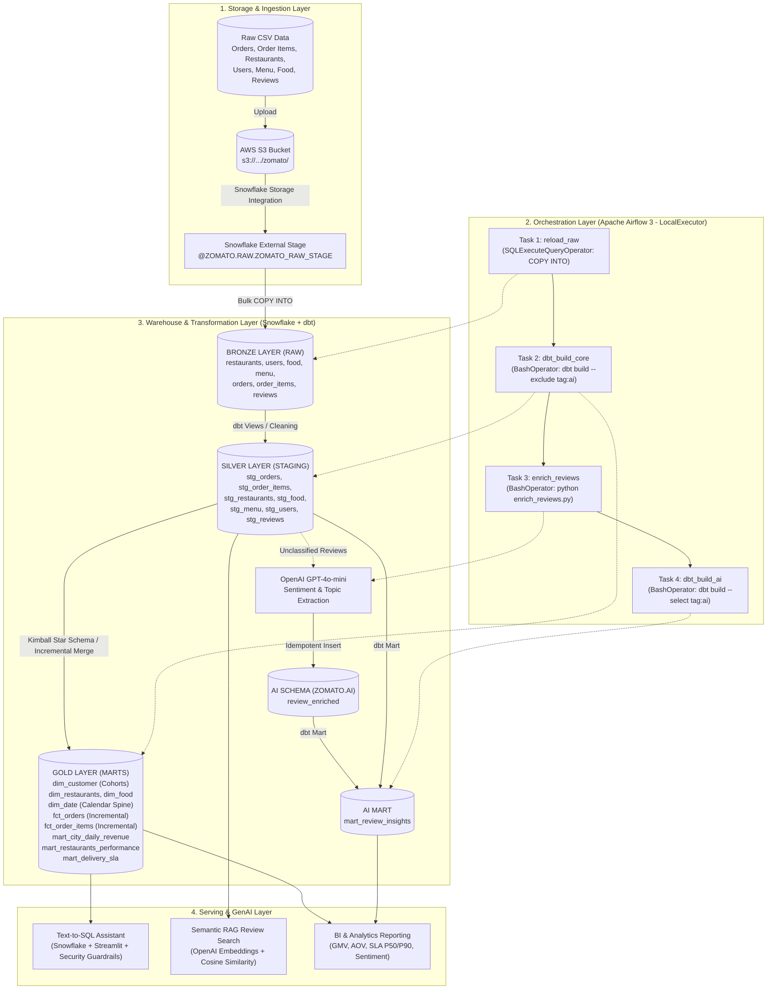
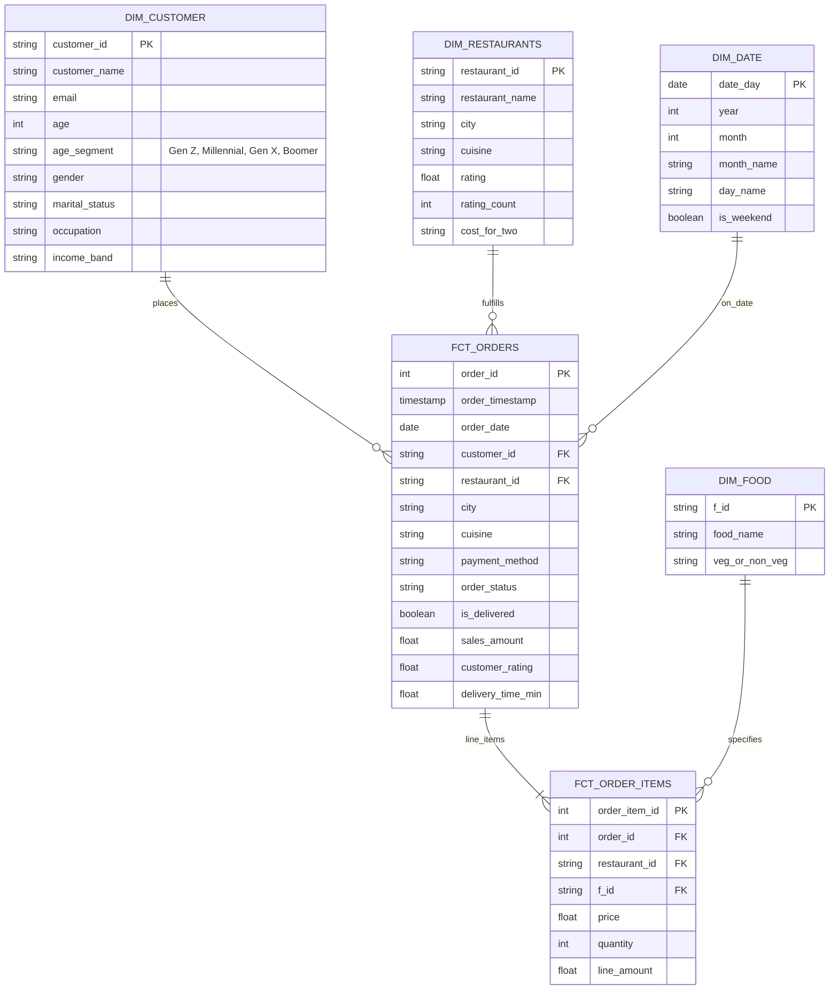

<div align="center">

# 🍽️ Zomato End-to-End Data Engineering & AI Platform

### *Production-Grade Modern Data Stack (MDS) Pipeline: AWS S3 • Snowflake • dbt Core • Apache Airflow 3 • GenAI*

[](https://www.snowflake.com/)
[](https://www.getdbt.com/)
[](https://airflow.apache.org/)
[](https://www.docker.com/)
[](https://aws.amazon.com/s3/)
[](https://www.python.org/)
[](https://openai.com/)
[](https://streamlit.io/)

---

A production-ready **Data Engineering Platform** architected on multi-million row food delivery datasets (Zomato). Built on the **Medallion Architecture**, this project implements automated **ELT data pipelines**, **Star Schema dimensional modeling**, **incremental materializations**, and **Apache Airflow 3 containerized orchestration**, paired with an **AI-driven enrichment layer** (LLM review classification, semantic vector search, and guardrailed Text-to-SQL).

</div>

---

## 📑 Table of Contents

- [Data Engineering Architecture](#-data-engineering-architecture)
- [Core Data Engineering Principles](#-core-data-engineering-principles)
- [Pipeline Orchestration (Apache Airflow 3)](#-pipeline-orchestration-apache-airflow-3)
- [Data Modeling & Medallion Layers (dbt)](#-data-modeling--medallion-layers-dbt)
  - [Bronze Layer (Raw)](#1-bronze-layer-raw-ingestion)
  - [Silver Layer (Staging)](#2-silver-layer-staging--cleaning)
  - [Gold Layer (Dimensional Marts)](#3-gold-layer-star-schema--business-marts)
  - [AI Layer (LLM Enrichment)](#4-ai-layer-enrichment--insights)
- [GenAI Applications in Data Engineering](#-genai-applications-in-data-engineering)
  - [1. LLM Pipeline Enrichment (GPT-4o-mini)](#1-llm-pipeline-enrichment-gpt-4o-mini)
  - [2. Guardrailed Text-to-SQL Engine](#2-guardrailed-text-to-sql-engine)
  - [3. Semantic RAG Search Engine](#3-semantic-rag-search-engine)
- [Data Quality, Testing & Governance](#-data-quality-testing--governance)
- [Project Directory Structure](#-project-directory-structure)
- [Infrastructure Setup & Quickstart](#-infrastructure-setup--quickstart)
  - [1. Environment Configuration](#1-environment-configuration)
  - [2. Snowflake Infrastructure & RBAC Setup](#2-snowflake-infrastructure--rbac-setup)
  - [3. Running Airflow 3 with Docker Compose](#3-running-airflow-3-with-docker-compose)
  - [4. Local dbt Operations](#4-local-dbt-operations)
  - [5. Serving Applications (Streamlit)](#5-serving-applications-streamlit)
- [Performance & Cost Optimization](#-performance--cost-optimization)
- [Author & Connect](#-author--connect)

---

## 🏗️ Data Engineering Architecture

The platform follows modern cloud data engineering best practices—separating storage from compute, moving all heavy transformations into Snowflake (ELT), and establishing an automated DAG in Airflow 3.



---

## ⚙️ Core Data Engineering Principles

| Principle | Implementation Details |
| :--- | :--- |
| **ELT over ETL** | Raw data is bulk-loaded as-is into Snowflake (`RAW`). Compute-intensive transformations, joins, and aggregations run in-warehouse using dbt, utilizing Snowflake's multi-cluster columnar compute engine. |
| **Idempotency & Replayability** | Every task in the pipeline is idempotent. The raw load tracks file checksums; incremental dbt models utilize primary-key `MERGE` logic; and the AI enrichment job filters strictly on `WHERE review_id NOT IN (SELECT review_id FROM ZOMATO.AI.REVIEW_ENRICHED)`. |
| **Incremental Processing** | High-volume fact tables (`fct_orders`, `fct_order_items`) process only new or updated records using timestamp high-watermarks (`order_timestamp > coalesce(max(order_timestamp), '1900-01-01')`), drastically reducing compute runtimes and Snowflake credit burn. |
| **Zero Missing Dates (Date Spine)** | Eliminates reporting gaps with a synthetic calendar dimension table (`dim_date`) created via Snowflake's `generator(rowcount=>1200)`, computing day-of-week, ISO weekend flags, and month metadata without external seeds. |
| **Dependency Isolation** | Airflow 3 and dbt run in the same container stack but inside **isolated virtual environments** (`/opt/airflow/dbt_venv`), preventing Python dependency conflicts between Airflow providers and `dbt-snowflake`. |

---

## ⏱️ Pipeline Orchestration (Apache Airflow 3)

The production DAG **`zomato_batch`** (`airflow/dags/zomato_batch.py`) automates data movement and pipeline execution:

```
reload_raw  ──►  dbt_build_core  ──►  enrich_reviews  ──►  dbt_build_ai
```

### Task Breakdown

1. **`reload_raw` (`SQLExecuteQueryOperator`)**:
   - Executes Snowflake `COPY INTO` commands loading raw CSV data from the external S3 stage (`@ZOMATO.RAW.ZOMATO_RAW_STAGE`).
   - Uses `ON_ERROR = 'CONTINUE'` on dimension tables to avoid crashing the pipeline on malformed rows.
2. **`dbt_build_core` (`BashOperator`)**:
   - Executes `dbt build --exclude tag:ai` in the dedicated dbt virtualenv.
   - Compiles and materializes all staging views, dimensions, incremental facts, and core business marts, running schema tests concurrently.
3. **`enrich_reviews` (`BashOperator`)**:
   - Triggers `ai/enrich_reviews.py` to extract pending customer reviews from Snowflake and stream them through OpenAI's `gpt-4o-mini` API.
   - Batch-inserts structured sentiment labels, continuous scores (`-1.0` to `1.0`), topic categories, and key issues into `ZOMATO.AI.REVIEW_ENRICHED`.
4. **`dbt_build_ai` (`BashOperator`)**:
   - Executes `dbt build --select tag:ai`.
   - Joins the newly enriched AI data with staging review metadata to materialize the aggregated `mart_review_insights` table.

---

## 📐 Data Modeling & Medallion Layers (dbt)

### 1. Bronze Layer (Raw Ingestion)
- **Schema**: `ZOMATO.RAW`
- **Tables**: `restaurants`, `users`, `food`, `menu`, `orders`, `order_items`, `reviews`.
- Raw, untyped data loaded directly from S3 CSV files without destructive transformations.

### 2. Silver Layer (Staging & Cleaning)
- **Schema**: `ZOMATO.STAGING` (Materialized as SQL `views`)
- **Key Transformations**:
  - `stg_orders`: Standardizes city strings (`regexp_substr(restaurant_city, '[^,]+$')`), generates boolean delivery flags (`(order_status = 'Delivered') as is_delivered`), and enforces numeric casting.
  - `stg_reviews`: Joins raw reviews with restaurant data to backfill city metadata and filters null comments.
  - `stg_restaurants`, `stg_food`, `stg_menu`, `stg_users`: Type-casting, column renaming, and whitespace trimming.

### 3. Gold Layer (Star Schema & Business Marts)
- **Schema**: `ZOMATO.MARTS` (Materialized as `table` and `incremental`)



#### Analytical Business Marts

- **`mart_city_daily_revenue`**:
  - Aggregated by `order_date` and `city`.
  - Calculates daily total orders, delivered volume, cancellation rate (`div0(cancelled, total)`), Gross Merchandise Value (**GMV**), and Average Order Value (**AOV**).
- **`mart_restaurants_performance`**:
  - Aggregated by `restaurant_id`, `name`, `city`, and `cuisine`.
  - Tracks total order counts, net delivered revenue, average customer ratings, and average delivery time in minutes.
- **`mart_delivery_sla`**:
  - Operational SLA tracking grouped by `city` and `order_hour`.
  - Computes exact **P50 (Median)** and **P90** delivery latency percentiles (`percentile_cont(0.9) within group (...)`) to monitor delivery performance.

### 4. AI Layer (Enrichment & Insights)
- **`ZOMATO.AI.REVIEW_ENRICHED`**: Stores per-review LLM predictions (sentiment label, continuous score, topic, and key issue phrase).
- **`mart_review_insights` (Tag: `ai`)**: Joins AI enrichment with review staging data, calculating average sentiment scores, star ratings, and total flagged issues grouped by `city`, `topic`, and `sentiment_label`.

---

## 🤖 GenAI Applications in Data Engineering

This platform demonstrates how to integrate Large Language Models (LLMs) into data engineering pipelines:

### 1. LLM Pipeline Enrichment (GPT-4o-mini)
- **Source Script**: [`ai/enrich_reviews.py`](file:///Users/sammarth/Downloads/Zomato%20AI%20Data%20Analytics/ai/enrich_reviews.py)
- Enforces strict **JSON schema output** via OpenAI's `response_format={"type": "json_object"}`.
- Categorizes reviews into operational topics (`food quality`, `delivery`, `pricing`, `service`, `packaging`, `other`) and extracts concise, actionable issue tags ($\le$ 6 words).
- High-performance batch insertion using `cursor.executemany()`.

### 2. Guardrailed Text-to-SQL Engine
- **Source Script**: [`ai/text_to_sql.py`](file:///Users/sammarth/Downloads/Zomato%20AI%20Data%20Analytics/ai/text_to_sql.py)
- Converts plain-English queries into optimized Snowflake SQL referencing the Gold Marts.
- **AST / Keyword Guardrails**:
  ```python
  FORBIDDEN_WORDS = ['drop', 'delete', 'truncate', 'alter', 'update', 'insert', 'create', 'replace', 'grant', 'revoke']
  def is_safe(sql):
      lowered = sql.lower()
      return (lowered.startswith("select") or lowered.startswith("with")) and not any(w in lowered for w in FORBIDDEN_WORDS)
  ```
- Executes queries against Snowflake and renders responsive tables and dynamic bar charts in Streamlit.

### 3. Semantic RAG Search Engine
- **Source Script**: [`ai/rag_chat.py`](file:///Users/sammarth/Downloads/Zomato%20AI%20Data%20Analytics/ai/rag_chat.py)
- Computes vector embeddings with OpenAI `text-embedding-3-small`.
- Implements **Parquet-based vector caching** (`review_embeddings.parquet`) to eliminate redundant embedding generation across runs.
- Executes cosine similarity search to retrieve the Top-K relevant reviews and synthesizes answers strictly grounded in actual customer feedback.

---

## 🧪 Data Quality, Testing & Governance

Data contracts and schemas are tested at build time using dbt generic tests:

```yaml
version: 2
models:
  - name: fct_orders
    columns:
      - name: order_id
        tests: [unique, not_null]
      - name: customer_id
        tests:
          - relationships:
              to: ref('dim_customer')
              field: customer_id
      - name: order_status
        tests:
          - accepted_values:
              values: ['Delivered', 'Cancelled', 'Refunded']
```

- **Referential Integrity**: Verified foreign-key relationships between fact and dimension tables.
- **Null & Uniqueness Checks**: Enforced on all primary keys.
- **Value Constraints**: Ensures categorical status fields conform to expected domain values.

---

## 📁 Project Directory Structure

```plaintext
.
├── README.md                                # Project documentation
├── pyproject.toml                           # Python project definition & dependencies
├── uv.lock                                  # Locked dependencies
├── .gitignore                               # Git rules (excludes secrets, venv, cache)
├── .env.example                             # Environment configuration template
│
├── airflow/                                 # Airflow 3 containerized orchestration
│   ├── docker-compose.yaml                  # Multi-container stack (API Server, Scheduler, Dag Processor)
│   ├── dockerfile                           # Airflow 3 + Snowflake provider + dbt venv
│   ├── .env.example                         # Airflow container env template
│   └── dags/
│       └── zomato_batch.py                  # Core batch ELT + AI DAG
│
├── zomato/                                  # dbt Core transformation project
│   ├── dbt_project.yml                      # dbt model and materialization configurations
│   ├── profiles.yml                         # Dynamic Snowflake profile (using env_var)
│   ├── macros/
│   │   └── generate_schema_name.sql         # Custom schema resolution macro
│   └── models/
│       ├── staging/                         # Silver Layer (Views)
│       │   ├── _sources.yml                 # Raw source definitions
│       │   ├── _ai_sources.yml              # AI source definitions
│       │   ├── _staging.yml                 # Staging schema tests
│       │   ├── stg_orders.sql
│       │   ├── stg_order_items.sql
│       │   ├── stg_restaurants.sql
│       │   ├── stg_food.sql
│       │   ├── stg_menu.sql
│       │   ├── stg_users.sql
│       │   └── stg_reviews.sql
│       └── marts/                           # Gold Layer (Tables & Incremental Marts)
│           ├── _marts.yml                   # Marts schema tests & documentation
│           ├── dim_customer.sql             # Demographic cohort dimension
│           ├── dim_restaurants.sql          # Restaurant dimension
│           ├── dim_food.sql                 # Food item dimension
│           ├── dim_date.sql                 # Synthetic calendar date spine
│           ├── fct_orders.sql               # Incremental orders fact table
│           ├── fct_order_items.sql          # Incremental order items fact table
│           ├── mart_city_daily_revenue.sql  # Revenue, GMV & cancellation mart
│           ├── mart_restaurants_performance.sql # Restaurant performance mart
│           ├── mart_delivery_sla.sql        # P50 & P90 delivery latency mart
│           └── mart_review_insights.sql     # AI-enriched review mart (tag: ai)
│
├── ai/                                      # GenAI pipelines & Streamlit applications
│   ├── enrich_reviews.py                    # LLM review classification script
│   ├── text_to_sql.py                       # Guardrailed Text-to-SQL Streamlit app
│   └── rag_chat.py                          # Semantic RAG review search app
│
└── data/                                    # Raw CSV data files (sample files)
```

---

## 🚀 Infrastructure Setup & Quickstart

### 1. Environment Configuration

```bash
git clone https://github.com/your-username/zomato-ai-data-engineering.git
cd zomato-ai-data-engineering

# Copy environment templates
cp .env.example .env
cp airflow/.env.example airflow/.env
```

Populate `.env` and `airflow/.env` with your credentials:

```ini
SNOWFLAKE_ACCOUNT=your_snowflake_account_identifier
SNOWFLAKE_USER=your_snowflake_user
SNOWFLAKE_PASSWORD=your_snowflake_password
SNOWFLAKE_WAREHOUSE=ZOMATO_WH
SNOWFLAKE_DATABASE=ZOMATO
SNOWFLAKE_SCHEMA=RAW
SNOWFLAKE_ROLE=DBT_ROLE

OPENAI_API_KEY=sk-proj-yourOpenAiKey
SAMPLE_N=50
```

Install local dependencies using `uv` or `pip`:

```bash
# Using uv (recommended)
uv venv
source .venv/bin/activate
uv pip install -e .

# Or using standard pip
python3 -m venv .venv
source .venv/bin/activate
pip install -r pyproject.toml
```

---

### 2. Snowflake Infrastructure & RBAC Setup

Execute the following DDL in a Snowflake Worksheet as `ACCOUNTADMIN`:

```sql
-- 1. Create Dedicated Role & Virtual Warehouse
CREATE ROLE IF NOT EXISTS DBT_ROLE;
CREATE WAREHOUSE IF NOT EXISTS ZOMATO_WH
    WITH WAREHOUSE_SIZE = 'XSMALL'
    AUTO_SUSPEND = 60
    AUTO_RESUME = TRUE
    INITIALLY_SUSPENDED = TRUE;

GRANT USAGE ON WAREHOUSE ZOMATO_WH TO ROLE DBT_ROLE;

-- 2. Create Database & Medallion Schemas
CREATE DATABASE IF NOT EXISTS ZOMATO;
GRANT USAGE, CREATE SCHEMA ON DATABASE ZOMATO TO ROLE DBT_ROLE;

CREATE SCHEMA IF NOT EXISTS ZOMATO.RAW;
CREATE SCHEMA IF NOT EXISTS ZOMATO.STAGING;
CREATE SCHEMA IF NOT EXISTS ZOMATO.MARTS;
CREATE SCHEMA IF NOT EXISTS ZOMATO.AI;

GRANT ALL PRIVILEGES ON ALL SCHEMAS IN DATABASE ZOMATO TO ROLE DBT_ROLE;
GRANT ALL PRIVILEGES ON FUTURE SCHEMAS IN DATABASE ZOMATO TO ROLE DBT_ROLE;
GRANT ALL PRIVILEGES ON ALL TABLES IN DATABASE ZOMATO TO ROLE DBT_ROLE;
GRANT ALL PRIVILEGES ON FUTURE TABLES IN DATABASE ZOMATO TO ROLE DBT_ROLE;

-- 3. Grant Role to User
GRANT ROLE DBT_ROLE TO USER <YOUR_USER>;
ALTER USER <YOUR_USER> SET DEFAULT_ROLE = DBT_ROLE;
ALTER USER <YOUR_USER> SET DEFAULT_WAREHOUSE = ZOMATO_WH;

-- 4. Create External Stage (S3)
USE SCHEMA ZOMATO.RAW;
CREATE OR REPLACE STAGE ZOMATO_RAW_STAGE
    URL = 's3://your-bucket-name/zomato/'
    FILE_FORMAT = (TYPE = 'CSV', SKIP_HEADER = 1, FIELD_OPTIONALLY_ENCLOSED_BY = '"');
```

---

### 3. Running Airflow 3 with Docker Compose

Launch the containerized Airflow 3 environment:

```bash
cd airflow

# Build custom image with dbt virtualenv & dependencies
docker compose build

# Start services
docker compose up -d
```

Open **[http://localhost:8080](http://localhost:8080)**:
- **Username**: `admin`
- **Password**: `admin`

Trigger the **`zomato_batch`** DAG to execute the full pipeline.

---

### 4. Local dbt Operations

Run dbt models and tests directly from your local terminal:

```bash
cd zomato

# Test Snowflake connectivity
dbt debug --profiles-dir .

# Run core models and tests
dbt build --exclude tag:ai --profiles-dir .

# Run AI mart
dbt build --select tag:ai --profiles-dir .

# Generate and view data lineage docs
dbt docs generate --profiles-dir .
dbt docs serve --profiles-dir .
```

---

### 5. Serving Applications (Streamlit)

Launch the interactive GenAI applications:

```bash
# 1. Text-to-SQL Assistant
streamlit run ai/text_to_sql.py

# 2. Semantic RAG Review Search
streamlit run ai/rag_chat.py
```

---

## 💰 Performance & Cost Optimization

1. **Auto-Suspension**: Snowflake virtual warehouses auto-suspend after 60 seconds of idle time.
2. **Watermark-Based Incremental Loading**: `fct_orders` and `fct_order_items` only scan and transform delta partitions based on `order_timestamp`, keeping warehouse runtimes under seconds.
3. **Idempotent AI Spending**: The enrichment script strictly processes un-enriched reviews, ensuring zero duplicate API spend with OpenAI.
4. **Vector Caching**: `ai/rag_chat.py` caches vector embeddings locally in Parquet format, avoiding repeated embedding generation costs.

---

## 👨‍💻 Author & Connect

**Sammarth**  
*Data & AI Engineer*  
- **GitHub**: [Sammarth14052018](https://github.com/Sammarth14052018)  
- **LinkedIn**: [Sammarth](https://www.linkedin.com/in/sammarth/?isSelfProfile=true)

---

<div align="center">
⭐ <i>If you found this data engineering pipeline valuable, please star the repository!</i> ⭐
</div>
